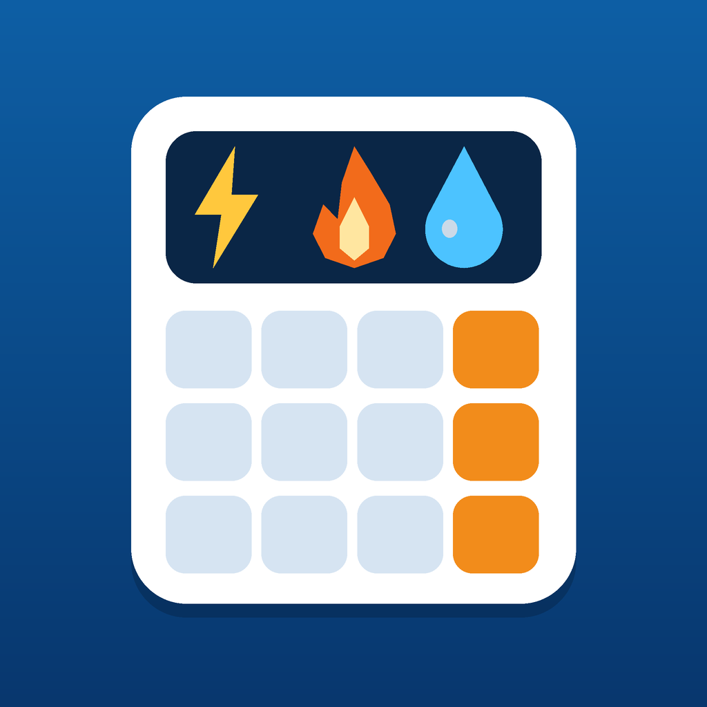

# DZ فاتورة — DZ Facture

<p align="center"></p>

**العربية** | [English](#english) | [Français](#français)

## العربية

حاسبة مفتوحة المصدر تقدّر فاتورة **الكهرباء والغاز** في الجزائر انطلاقاً من بيان العدادين القديم والجديد. تعمل دون إنترنت، وتدعم العربية والإنجليزية والفرنسية، والوضعين الفاتح والداكن.

> ⚠️ **تنبيه:** هذا مشروع مستقل **غير تابع لسونلغاز** ولا لأي جهة رسمية. النتيجة تقريبية وقد تختلف عن الفاتورة الرسمية بسنتيم واحد أو أكثر. الفاتورة الرسمية هي المرجع.

### التشغيل السريع
افتح `www/index.html` في أي متصفح. لا يلزم تثبيت شيء.

### الاختبارات
```bash
npm test      # يتطلب Node.js 20 أو أحدث
```
الاختبارات تقارن النتائج بفواتير حقيقية في `tests/bills.json`.

### بناء تطبيق أندرويد
يتطلب Node.js 20+ وJDK 21 وAndroid Studio (SDK 36):
```bash
bash setup.sh          # ينشئ مشروع أندرويد ويولّد الأيقونات ويضبط API 36
npx cap open android   # ثم Build > Generate Signed Bundle
```

### هيكل المشروع
| المسار | الوظيفة |
|---|---|
| `www/tariffs.js` | **الأسعار والرسوم** (عدّله عند تغيّر التعريفة) |
| `www/calc.js` | منطق الحساب بلا واجهة |
| `www/index.html` | الواجهة والترجمات (ar / en / fr) والوضع الداكن |
| `tests/` | اختبارات وفواتير مرجعية |
| `resources/` | الأيقونة (تُحوَّل إلى أحجام أندرويد بـ `setup.sh`) |

### المساهمة
أكبر حاجة للمشروع هي **تصحيح الأرقام**: افتح *Issue* بقالب «تصحيح تعريفة / فاتورة» وأرفق قراءات العدادين والمبالغ. **أخفِ الاسم والعنوان ورقم العداد قبل نشر أي صورة**. التفاصيل في [CONTRIBUTING.md](CONTRIBUTING.md).

### مسائل معروفة
- فرق سنتيم واحد في TVA على بعض الفواتير (تقريب).
- سعر الشطر 4 للكهرباء (>750 kWh) والحق الثابت لما دون 70 kWh لم يُتحقق منهما من فاتورة فعلية.
- فاتورة الماء قيد الإضافة.

### الترخيص
MIT — انظر [LICENSE](LICENSE).

---

## English

Open-source calculator that estimates an Algerian **electricity and gas** bill from old/new meter readings. Works offline; Arabic, English, French; light and dark themes.

> ⚠️ **Disclaimer:** independent project, **not affiliated with Sonelgaz** or any authority. Results are estimates and may differ from the official bill (at least by rounding). The official bill is authoritative.

- **Run:** open `www/index.html` in a browser.
- **Test:** `npm test` (Node.js 20+).
- **Build Android:** `bash setup.sh`, then `npx cap open android` (needs JDK 21 and Android Studio with SDK 36).
- **Update prices:** edit only `www/tariffs.js`.
- **Contribute:** the most valuable help is verifying numbers against real bills. See [CONTRIBUTING.md](CONTRIBUTING.md). Always redact name, address and meter number from any bill image.
- **Known issues:** 1-centime VAT rounding difference on some bills; electricity tier 4 price and fixed charge below 70 kWh are unverified; water bills are planned.
- **License:** MIT.

---

## Français

Calculateur open source qui estime une facture **d'électricité et de gaz** en Algérie à partir des index. Fonctionne hors ligne ; arabe, anglais, français ; thèmes clair et sombre.

> ⚠️ **Avertissement :** projet indépendant, **non affilié à Sonelgaz**. Les résultats sont des estimations pouvant différer de la facture officielle. La facture officielle fait foi.

- **Lancer :** ouvrir `www/index.html` dans un navigateur.
- **Tests :** `npm test` (Node.js 20+).
- **Android :** `bash setup.sh` puis `npx cap open android`.
- **Tarifs :** modifier uniquement `www/tariffs.js`.
- **Contribuer :** vérifier les chiffres avec de vraies factures (masquer nom, adresse et numéro de compteur). Voir [CONTRIBUTING.md](CONTRIBUTING.md).
- **Licence :** MIT.
